# West City Bank – Event-Driven Account Opening Integration

Prototype for **UTS 32113 Advanced Database, Assignment 2** (group Wrk1-01).

A customer opens a new transaction account in West City Bank's mobile app.
The account-opening event must reach the **fraud engine**, **CRM**,
**loyalty** and the **data warehouse** reliably and quickly, without making
the customer wait. This prototype does that with a transactional outbox,
Debezium change data capture and Kafka. A medallion data warehouse (bronze →
silver Data Vault → gold star schema) feeds three live dashboards.

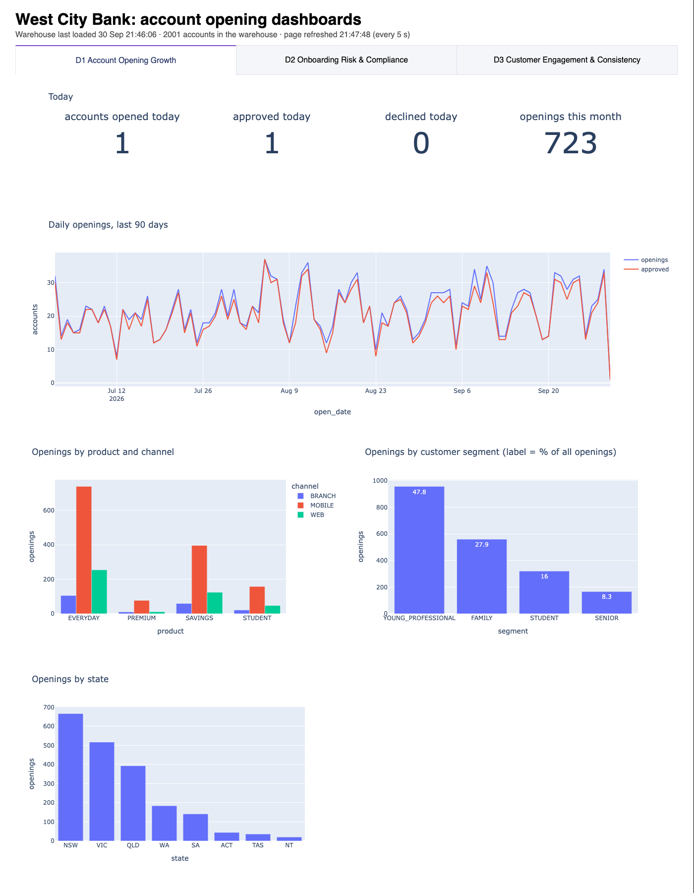

---

## Contents
1. [Objectives](#1-objectives)
2. [Quick start](#2-quick-start)
3. [System architecture](#3-system-architecture)
4. [How the data flows](#4-how-the-data-flows)
5. [Components](#5-components)
6. [Dashboards](#6-dashboards)
7. [Demo](#7-demo)
8. [Project structure](#8-project-structure)
9. [Design decisions and lab simplifications](#9-design-decisions-and-lab-simplifications)
10. [Useful commands and troubleshooting](#10-useful-commands-and-troubleshooting)

---

## 1. Objectives

**Business goal:** when a customer opens an account, every system that needs
to know hears about it within seconds, each adds what only it knows, and the
bank sees the combined result in one place.

| Use case (Assignment 1) | What the prototype shows | Where to see it |
|---|---|---|
| **UC1** Event propagation | One database commit in core banking reaches 4 independent consumers through the outbox, Debezium and Kafka, typically in under a second | Consumer logs; `demo/03_trace_account.sql`; dashboard D1 |
| **UC2** Timely fraud / AML data | Every new account is scored (device sharing, KYC, watchlist) about 0.5 s after it opens | Dashboard D2 |
| **UC3** Consistent multi-system state | Idempotent consumers and versioned upserts; the four cross-system consistency checks stay at 0 | Dashboard D3 |
| **UC4** Fault-tolerant decoupling | Stop one consumer: the others keep working, Kafka keeps its events, and it catches up on restart with nothing lost or applied twice | Demo scene 6 |
| **UC5** Audit and lineage | Event ids, transaction ids, Kafka topic / partition / offset, `run_id` on every warehouse row, insert-only history, data-quality quarantine | `bronze.core_event`, `ops.etl_run`, `silver.sat_*` |
| **UC6** Streaming vs batch latency | The trace shows each system receiving events within seconds (streaming), while the warehouse is loaded in batches | `demo/03_trace_account.sql` |

**Assignment deliverables covered:** 4 source databases, 1 integrated
warehouse, fully commented SQL (create, extract, transform, load) with
synthetic data, 3 dashboards, and a scripted end-to-end demo.

---

## 2. Quick start

**Needs:** Docker Desktop (about 4 GB of memory for the containers), and free
ports 5433, 8050, 8083, 8978 and 9092.

```bash
# 1. Build and start everything. The first build takes a few minutes; wait
#    until `docker compose ps` shows postgres, kafka and connect as healthy.
docker compose up -d --build

# 2. Create the 90-day history. It goes through the real pipeline (Kafka).
#    The number of accounts is `\set seed_count` at the top of the file;
#    use 2000 for meaningful charts.
docker compose exec -T postgres psql -U westcity_admin -d core_banking < seed/seed_history.sql

# 3. When the fraud consumer has scored them (docker compose logs consumer-fraud),
#    apply the decisions: APPROVE -> ACTIVE, DECLINE -> REJECTED.
docker compose exec -T postgres psql -U westcity_admin -d core_banking < demo/apply_decisions.sql

# 4. About 10 s later, load the warehouse: bronze -> silver -> gold.
docker compose exec postgres psql -U westcity_admin -d westcity_dw -f /etl/run_all.sql

# 5. Open the live dashboards.
open http://localhost:8050
```

**Start again from zero** (Postgres and Kafka must be reset together):
```bash
docker compose down
docker volume rm westcity_pgdata westcity_kafkadata
docker compose up -d --build
```

| Tool | Address | Login (lab only) |
|---|---|---|
| Live dashboards | http://localhost:8050 | – |
| CloudBeaver (web SQL editor) | http://localhost:8978 | connection: host `postgres`, port `5432` |
| PostgreSQL from your machine | `localhost:5433` | `westcity_admin` / `lab_admin` |
| Kafka from your machine | `localhost:9092` | – |
| Kafka Connect REST API | http://localhost:8083/connectors | – |

---

## 3. System architecture

Everything runs in Docker Compose, one container per component.

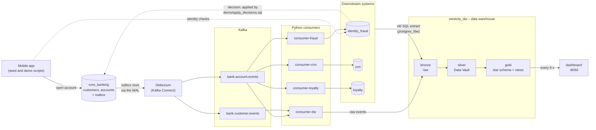

All five databases (core_banking, identity_fraud, crm, loyalty, westcity_dw)
live in **one PostgreSQL 15 container**, a lab simplification.

| Compose service | Image | Role |
|---|---|---|
| `postgres` | postgres:15.18 | All five databases; runs `sql/01`–`09` on first start |
| `kafka` | apache/kafka:4.3.1 | Event transport (KRaft mode, no ZooKeeper) |
| `connect` | quay.io/debezium/connect:3.6.3.Final | Debezium: reads `core_banking.outbox` from the write-ahead log |
| `connect-init` | curlimages/curl | Registers `connectors/core-outbox.json` once, then exits |
| `consumer-fraud` / `-crm` / `-loyalty` / `-dw` | `python/Dockerfile` | One Python script (`consumers/consumer.py`), four instances |
| `dashboard` | `python/Dockerfile` | Live web dashboards (Plotly Dash) on port 8050 |
| `python` | `python/Dockerfile` | Course-lab style shell for running scripts (e.g. the HTML export) |
| `cloudbeaver` | dbeaver/cloudbeaver | Web SQL editor |

---

## 4. How the data flows

### 4.1 One account, end to end

This is what happens when Mia opens an account (demo scenes 1–4). Steps 3–6
take about a second in total.

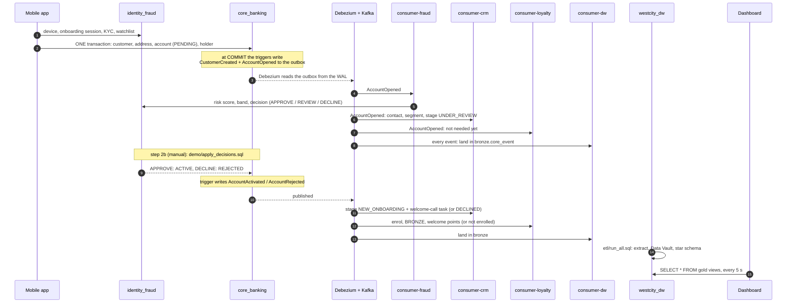

### 4.2 Why nothing is lost and nothing is applied twice

- **Transactional outbox.** The account and its event are written in the
  same database transaction: either both exist or neither does.
- **Debezium** reads committed outbox rows from the write-ahead log and
  publishes them. The key is the account or customer id, so all events of
  one account go to the same partition, in order.
- **Every consumer** runs the same loop:

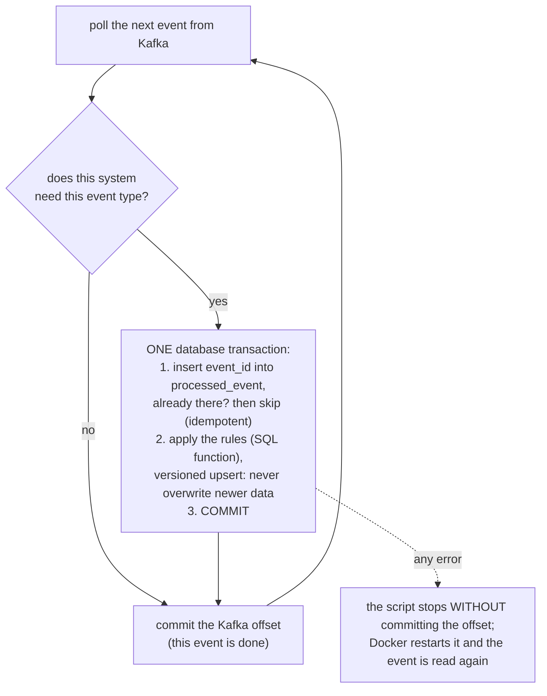

Delivery is **at-least-once**. The `processed_event` table (or, in the
warehouse, the event id as primary key) turns it into **exactly-once in
effect**.

### 4.3 The 90-day history

`seed/seed_history.sql` runs after the stack is up and plays the mobile app
for `seed_count` new customers. It picks every field at random, with weights,
from hard-coded lists (names, ages, suburbs, products, channels, KYC and
watchlist results, devices). The weights reproduce the spec's percentages:
for example, channel MOBILE 70 / WEB 20 / BRANCH 10. Opening dates are
spread over the last 90 days, with a rising trend and fewer openings at
weekends.

The history then travels exactly the same path as a live account: outbox,
Kafka, consumers, decisions, warehouse. `SELECT setseed(0.42)` makes every
rebuild produce the same data.

### 4.4 Into the warehouse and onto the dashboard

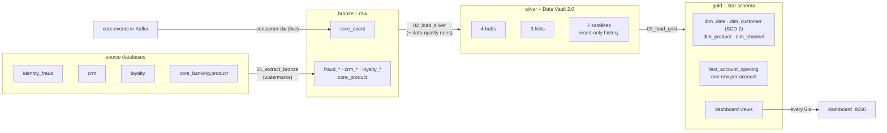

---

## 5. Components

### 5.1 Core banking (`core_banking`): the system of record

Owns customers and accounts. It never calls the other systems; it only
writes events to its **outbox**.

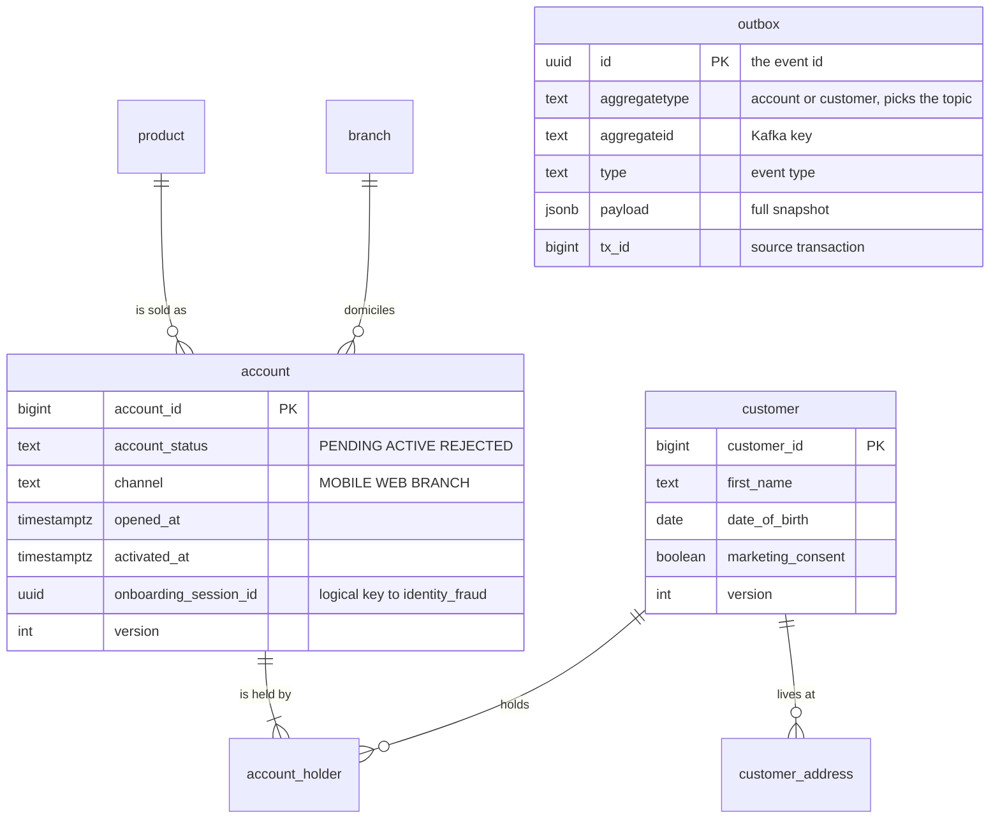

| Change | Trigger (`sql/03_outbox_triggers.sql`) | Event |
|---|---|---|
| New customer | deferred to COMMIT, so the address is included | `CustomerCreated` |
| Customer details change | after update | `CustomerDetailsUpdated` |
| New account | deferred to COMMIT, so the holders are included | `AccountOpened` |
| Status becomes ACTIVE / REJECTED | after update of `account_status` | `AccountActivated` / `AccountRejected` |

Every business change also adds 1 to the aggregate's `version`. Each account
event carries a full snapshot of the account and of every holder's customer
record, so a consumer can act on one event alone. There is no ordering
between the two topics.

### 5.2 Debezium and Kafka

- The publication `dbz_outbox_publication` contains **only the outbox**, so
  internal tables are never exposed.
- The **EventRouter** turns each outbox row into a clean business event:

| Kafka | Value |
|---|---|
| Topic | `bank.<aggregatetype>.events`: `bank.account.events`, `bank.customer.events` |
| Key | `aggregateid` (account id or customer id), so events are ordered per account |
| Value | the JSON payload (below) |
| Headers | `id`, `type`, `event_version`, `tx_id` |
| Partitions | 3 per topic (replication factor 1: single broker) |

```json
{
  "schema_version": 1,
  "event_id": "fdf174b4-…",
  "event_type": "AccountOpened",
  "aggregate_type": "account",
  "aggregate_id": "2001",
  "aggregate_version": 1,
  "occurred_at": "2026-09-30T21:45:21.635+10:00",
  "producer": "core_banking",
  "data": {
    "account_id": 2001, "version": 1, "product_code": "EVERYDAY", "channel": "MOBILE",
    "account_status": "PENDING", "opened_at": "…", "onboarding_session_id": "…",
    "holders": [{ "customer_id": 2001, "holder_role": "PRIMARY",
                  "customer": { "first_name": "Mia", "date_of_birth": "…",
                                "marketing_consent": true, "version": 1, "…": "…" } }]
  }
}
```
*Debezium leaves out fields that are NULL (e.g. `activated_at` of a PENDING
account), so consumers read optional fields with `.get()`.*

### 5.3 Consumers (`consumers/consumer.py`)

One script, four Compose services. All business rules are in SQL functions;
Python only moves data.

| Service | Consumer group | Reads | Acts on | Calls | Writes to |
|---|---|---|---|---|---|
| `consumer-fraud` | `fraud-consumer` | account topic | AccountOpened | `fraud_assess_account()` | identity_fraud |
| `consumer-crm` | `crm-consumer` | account topic | Opened, Activated, Rejected | `crm_onboard_account()` | crm |
| `consumer-loyalty` | `loyalty-consumer` | account topic | Activated, Rejected | `loyalty_onboard_account()` | loyalty |
| `consumer-dw` | `dw-consumer` | both topics | every event | `bronze.land_core_event()` | westcity_dw |

### 5.4 Identity & Fraud (`identity_fraud`)

Owns devices, onboarding sessions, KYC and watchlist results, and the risk
decision. Its rules are in `sql/05_fraud_scoring.sql`.

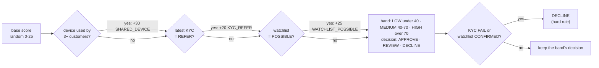

The score is capped at 100. The decision time is 5–120 s after opening.
**REVIEW is final** in this prototype: the account stays PENDING.

### 5.5 Decision step 2b (`demo/apply_decisions.sql`)

A manual SQL step, in place of a real fraud-case workflow. One `UPDATE` in
core_banking reads `identity_fraud.risk_assessment` through a read-only
postgres_fdw link. APPROVE sets ACTIVE (activated at the decision time) and
DECLINE sets REJECTED. The status change fires the triggers, so
`AccountActivated` / `AccountRejected` flow out through Kafka.

### 5.6 CRM (`crm`)

Its rules are in `sql/04_crm_onboarding.sql`.

| Field | Rule |
|---|---|
| Segment | Age at opening: STUDENT < 23, YOUNG_PROFESSIONAL 23–35, FAMILY 36–55, SENIOR > 55 |
| Lifecycle stage | REJECTED → DECLINED; ACTIVE and opened < 30 days ago → NEW_ONBOARDING; ACTIVE older → ESTABLISHED; PENDING → UNDER_REVIEW |
| Welcome-call task | Only for ACTIVE accounts, opened 0–24 h after activation; COMPLETED (85%) if older than 7 days, else OPEN |

### 5.7 Loyalty (`loyalty`)

Its rules are in `sql/06_loyalty_onboarding.sql`.

| Field | Rule |
|---|---|
| Eligibility | Enrol only if the account is ACTIVE **and** the customer gave marketing consent |
| Tier | BRONZE for every new member |
| Welcome offer | EVERYDAY 5,000 points; SAVINGS 3,000; any other product 1,000 |
| Redemption | REDEEMED (60%) if assigned more than 14 days ago, else ASSIGNED |
| Rejection | Never enrolled; an enrolled account that is rejected becomes UNENROLLED |

### 5.8 Data warehouse (`westcity_dw`)

| Layer | Contents | Loaded by |
|---|---|---|
| **bronze** | Raw data as it arrived: `core_event` (every core event, with Kafka topic / partition / offset) and one table per extracted source table | consumer-dw (live) and `etl/01_extract_bronze.sql` |
| **silver** | Data Vault 2.0: hubs (business keys), links (relationships), satellites (attributes with full, insert-only history) | `etl/02_load_silver.sql` |
| **gold** | Star schema, plus every dashboard query as a view (`sql/09_reports_dashboards.sql`) | `etl/03_load_gold.sql` |
| **ops** | `etl_run` (one row per run, its `run_id` stamped on every row it writes), `dq_quarantine`, `extract_watermark` | all ETL scripts |

**Incremental extract.** `ops.extract_watermark` remembers how far each
table has been read.

| Tables | How new or changed rows are found |
|---|---|
| device, kyc_verification, watchlist_screening, risk_assessment, crm_case | Id above the watermark (insert-only tables) |
| crm_contact, crm_financial_account, loyalty_member, member_offer | `synced_at` after the watermark (rows are updated) |
| product, loyalty_offer, onboarding_session | Copied in full (small, or no usable watermark) |

**Silver: Data Vault 2.0.** Hash keys are MD5 of the business key. A
satellite row is added only when its `hash_diff` changes.

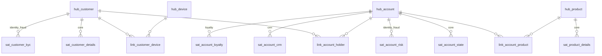

**Data-quality rules** (in the silver load): every account has one PRIMARY
holder, and every customer is an adult with a date of birth. Failing rows go
to `ops.dq_quarantine` with the reason, instead of into silver.

**Gold: star schema.** `dim_customer` keeps history (SCD type 2). The fact
table is rebuilt from silver on every load.

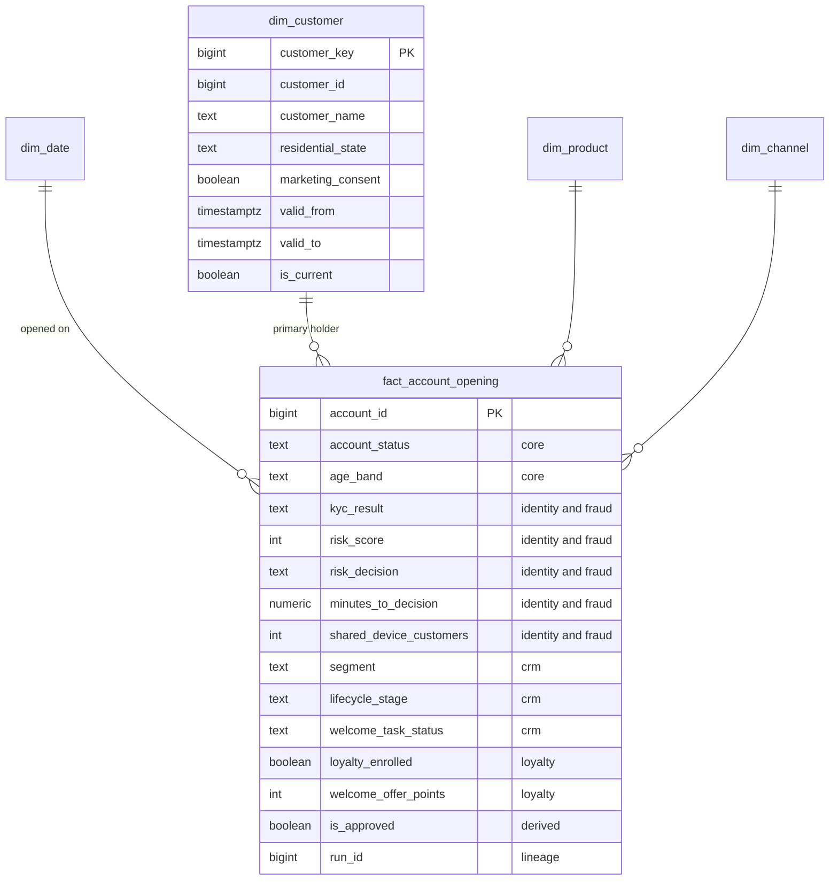

---

## 6. Dashboards

**Live web app:** http://localhost:8050 (`dashboards/app.py`, Plotly Dash).
- **Tabs:** one per dashboard.
- **Live:** the page re-reads the gold views every 5 seconds, so a warehouse
  load appears without reloading.
- **Interactive:** hover for values, drag to zoom, double-click to reset,
  click a legend item to hide a series. Zoom is kept across refreshes.
- **Static copies:** the same charts can be saved as HTML files with
  `docker compose exec python python /workspace/dashboards/build_dashboards.py`
  (output in `dashboards/output/`).

**Rule:** every number comes from a commented SQL view in
`sql/09_reports_dashboards.sql`. Python only runs `SELECT * FROM gold.<view>`
and draws the result.

*The screenshots below come from a test run with about 2,000 seeded accounts.*

### D1 Account Opening Growth (business, UC1)
Is account opening growing, through which products and channels, and who is opening?

| View | Chart |
|---|---|
| `vw_d1_kpi_today` | KPIs: opened, approved and declined today; openings this month |
| `vw_d1_daily_openings` | Line: openings and approvals per day, last 90 days |
| `vw_d1_openings_by_product_channel` | Grouped bar |
| `vw_d1_openings_by_segment` | Bar, with % of all openings |
| `vw_d1_openings_by_state` | Bar |
| `vw_d1_latest_openings` | Table: the 15 newest openings and what each system decided |

(Screenshot at the top of this page.)

### D2 Onboarding Risk & Compliance (UC2)
How risky are new customers, what triggers the risk, and how fast do we decide?

| View | Chart |
|---|---|
| `vw_d2_decision_mix` | Stacked bar: APPROVE / REVIEW / DECLINE by channel |
| `vw_d2_risk_band_weekly` | Stacked bar: risk bands per week |
| `vw_d2_shared_device_rings` | Bar: devices used by 3+ customers (possible fraud rings) |
| `vw_d2_time_to_decision` | Line: average minutes to decision, % within 5 minutes |
| `vw_d2_top_reason_codes` | Bar: the most common risk reasons |

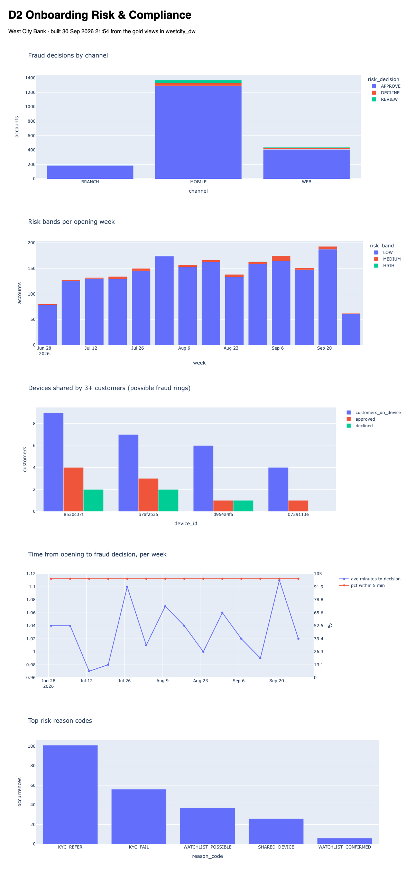

### D3 Customer Engagement & Consistency (UC3)
Are approved customers being engaged, and do all systems agree?

| View | Chart |
|---|---|
| `vw_d3_loyalty_enrolment_by_segment` | Grouped bar: approved vs enrolled (about 70% consent) |
| `vw_d3_welcome_offers_monthly` | Bars: points committed per month; line: % redeemed |
| `vw_d3_welcome_call_coverage` | Lines: approved accounts, welcome tasks, % completed |
| `vw_d3_consistency_checks` | Table: declined but enrolled · declined but ACTIVE in CRM · approved but missing in CRM · approved + consented but not enrolled: **all 0** |

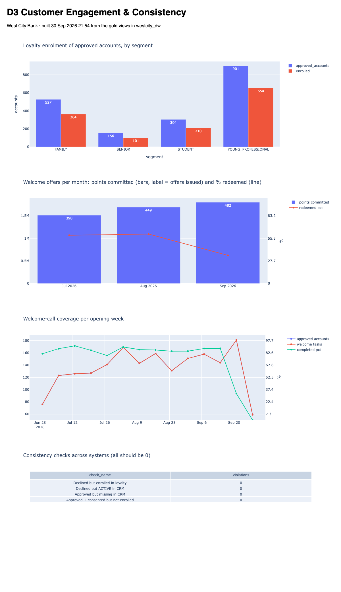

---

## 7. Demo

The full script, with commands, what to show and what to say, is in
**[demo/DEMO_SCRIPT.md](demo/DEMO_SCRIPT.md)**.

| Scene | What happens |
|---|---|
| 0 | Show the live dashboard: *accounts opened today = 0* |
| 1 | `demo/01_open_account_mia.sql`: Mia opens an EVERYDAY account; the consumer log shows all 4 systems reacting within a second |
| 2 | `demo/apply_decisions.sql`, then `demo/03_trace_account.sql`: follow Mia through core, Kafka, fraud (APPROVE), CRM (NEW_ONBOARDING + welcome call), loyalty (BRONZE, 5,000 points) |
| 3 | `etl/run_all.sql`: the warehouse load; the trace now shows her silver history and gold row |
| 4 | The dashboard updates by itself: opened today = 1, Mia at the top of the latest openings |
| 5 | `demo/02_open_account_alex_fraud.sql`: Alex, on a fraud-ring device with a failed KYC, is declined everywhere; D2 shows the ring grow; D3 checks stay 0 |
| 6 | Optional: stop `consumer-loyalty`, open an account, restart it: loyalty catches up and nothing is lost |

---

## 8. Project structure

```
.
├── docker-compose.yml          all services (read the header for commands)
├── connectors/
│   └── core-outbox.json        Debezium connector: outbox -> Kafka
├── sql/                        run once, in name order, on an empty database
│   ├── 01_create_databases.sql the five databases
│   ├── 02_create_tables.sql    every table (sources + bronze/silver/gold/ops)
│   ├── 03_outbox_triggers.sql  core_banking: outbox triggers + publication
│   ├── 04_crm_onboarding.sql   CRM rules          crm_onboard_account()
│   ├── 05_fraud_scoring.sql    fraud rules        fraud_assess_account()
│   ├── 06_loyalty_onboarding.sql loyalty rules    loyalty_onboard_account()
│   ├── 07_reference_data.sql   branches, products, ring devices, offers
│   ├── 08_warehouse_setup.sql  postgres_fdw links, watermarks, Kafka landing
│   └── 09_reports_dashboards.sql every dashboard query as a gold view
├── seed/
│   └── seed_history.sql        90-day history through the pipeline (seed_count)
├── consumers/
│   └── consumer.py             the Kafka consumer (fraud | crm | loyalty | dw)
├── etl/                        warehouse load, run on demand
│   ├── 01_extract_bronze.sql   sources -> bronze (incremental)
│   ├── 02_load_silver.sql      bronze -> Data Vault (+ data quality)
│   ├── 03_load_gold.sql        Data Vault -> star schema
│   └── run_all.sql             all three, in order
├── dashboards/
│   ├── charts.py               the charts, defined once
│   ├── app.py                  live web app (http://localhost:8050)
│   ├── build_dashboards.py     static HTML export -> dashboards/output/
│   └── output/                 exported HTML files
├── demo/
│   ├── DEMO_SCRIPT.md          the video, scene by scene
│   ├── 01_open_account_mia.sql
│   ├── 02_open_account_alex_fraud.sql
│   ├── 03_trace_account.sql
│   └── apply_decisions.sql     step 2b: apply fraud decisions
├── python/                     image for consumers and dashboards
│   ├── Dockerfile              course-lab python:3.11-slim
│   └── requirements.txt        pinned: psycopg2, confluent-kafka, pandas, plotly, dash
├── docs/
│   ├── demo-flow.md            the spec: story, rules, data, dashboards
│   └── images/                 screenshots used in this README
└── westcity-er-model-source.md ER model (Mermaid) from the design phase
```

---

## 9. Design decisions and lab simplifications

**Design decisions**
- **Transactional outbox + CDC** instead of the app calling each system:
  the customer never waits for fraud, CRM or loyalty, and no event is lost
  if one of them is down.
- **Events carry full snapshots** (account + holders' customer records), so
  each consumer can act on one event alone. Kafka only orders events within
  one partition, and there is no ordering between topics.
- **Rules live in SQL functions**, one per system, so they are commented,
  testable and the same for history and live accounts.
- **Core data reaches the warehouse through Kafka** (consumer-dw). Fraud, CRM
  and loyalty results are not published to Kafka, so they are extracted
  with SQL (postgres_fdw + watermarks).
- **Medallion warehouse:** raw bronze for replay and lineage; a Data Vault
  in silver for full history; a star schema in gold for fast, simple
  reporting.
- **Business time is Australia/Sydney** (head office), although
  Assignment 1 places West City in Western Australia.

**Lab simplifications** (production would differ)
- One PostgreSQL container for all five databases, linked with postgres_fdw;
  production would use separate servers.
- One superuser for every component; production would give each service
  least-privilege roles.
- One Kafka broker, replication factor 1; production would use RF = 3 and
  `min.insync.replicas = 2`, plus replication-slot lag monitoring.
- Rules-based fraud score instead of a model. The fraud decision is applied
  by a manual SQL step, and REVIEW is final.
- No Schema Registry: the event contract is a versioned JSON envelope
  (`schema_version`).
- Id / timestamp watermarks can miss a row committed out of order;
  production would extract by log position or with an overlap window.
- Kafka keeps events for 7 days by default, so bronze cannot be rebuilt from
  Kafka after that.

---

## 10. Useful commands and troubleshooting

```bash
# Watch the four consumers live
docker compose logs -f consumer-fraud consumer-crm consumer-loyalty consumer-dw

# Follow one account through every system (default: the newest account)
docker compose exec -T postgres psql -U westcity_admin -d core_banking -v account_id=2001 < demo/03_trace_account.sql

# SQL shell
docker compose exec postgres psql -U westcity_admin -d core_banking

# Connector status
curl -s http://localhost:8083/connectors/core-outbox/status

# Read the raw events in Kafka
docker compose exec kafka /opt/kafka/bin/kafka-console-consumer.sh \
  --bootstrap-server kafka:29092 --topic bank.account.events \
  --from-beginning --property print.key=true

# How far behind a consumer is (LAG column)
docker compose exec kafka /opt/kafka/bin/kafka-consumer-groups.sh \
  --bootstrap-server kafka:29092 --describe --group loyalty-consumer

# ETL audit: every warehouse run
docker compose exec postgres psql -U westcity_admin -d westcity_dw \
  -c "SELECT run_id, job_name, status, rows_loaded, rows_rejected FROM ops.etl_run ORDER BY run_id DESC LIMIT 6"
```

| Problem | Fix |
|---|---|
| The dashboard does not change after new accounts | It reads the warehouse: run `etl/run_all.sql`; the page updates within 5 s |
| `apply_decisions.sql` returns 0 rows | The fraud consumer has not scored the accounts yet; wait a moment and run it again |
| Charts are almost empty | Set `\set seed_count 2000` in `seed/seed_history.sql`, then rebuild and seed again |
| A change in `sql/` has no effect | The `sql/` scripts only run on an empty database: rebuild from zero (section 2) |
| The connector is not RUNNING | `docker compose logs connect`; after a partial reset, rebuild Postgres and Kafka **together** |


# Re-start Docker images
docker compose down --volumes --rmi all --remove-orphans
docker compose build --no-cache --pull
docker compose up -d