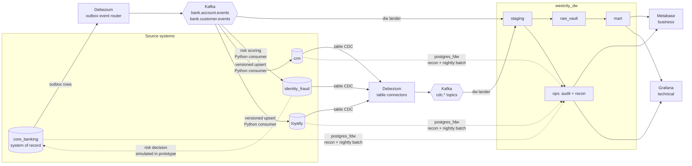
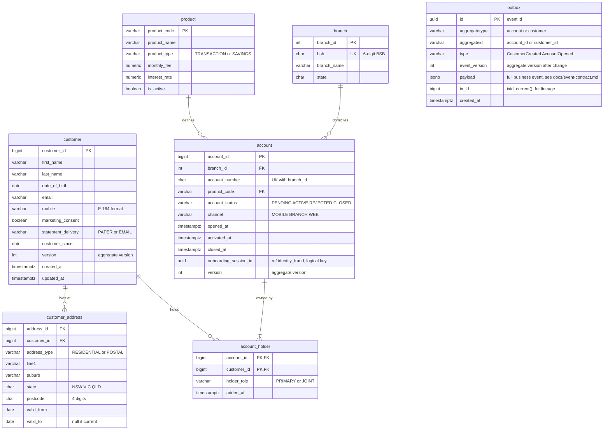
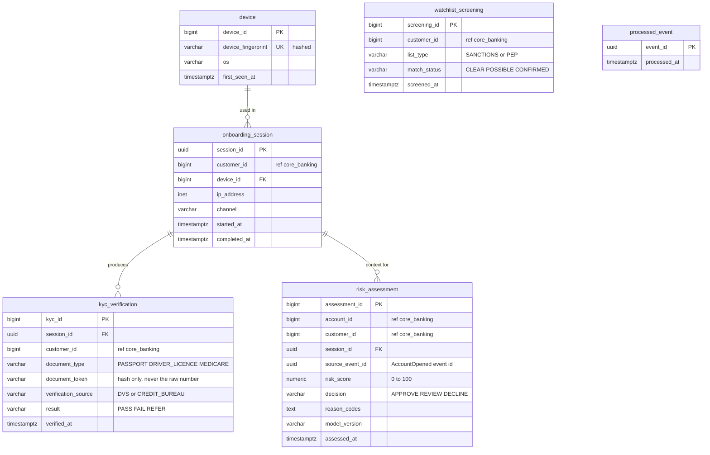
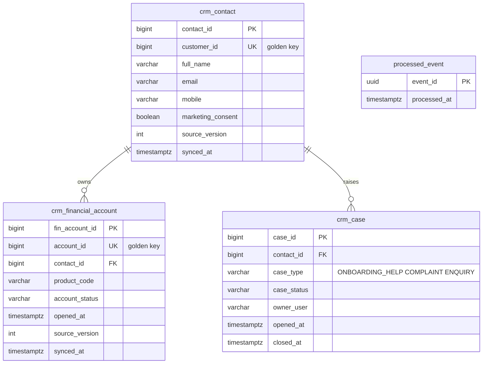
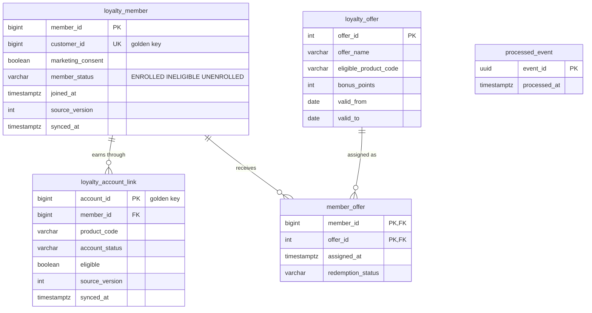
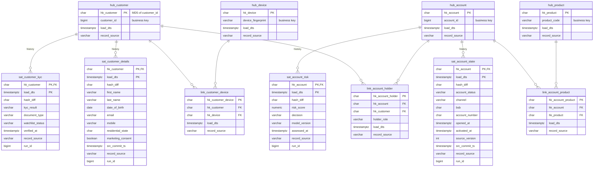
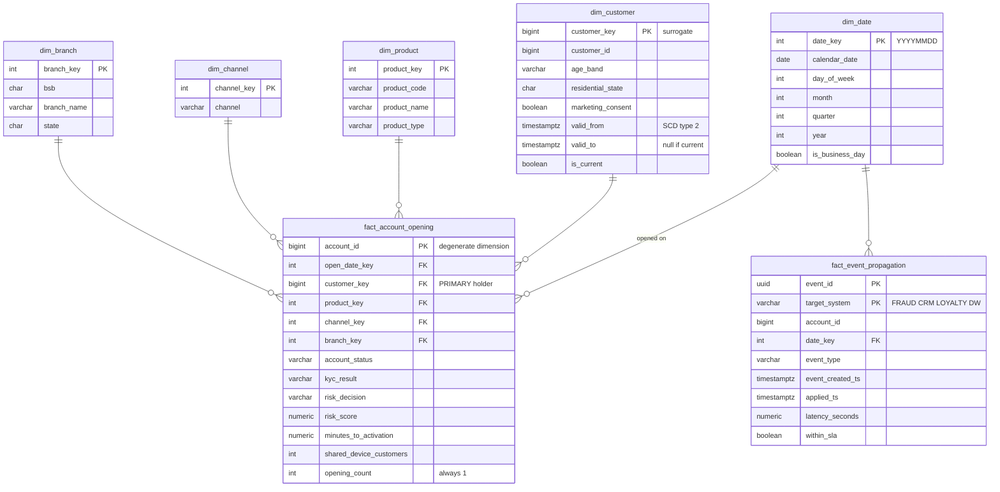
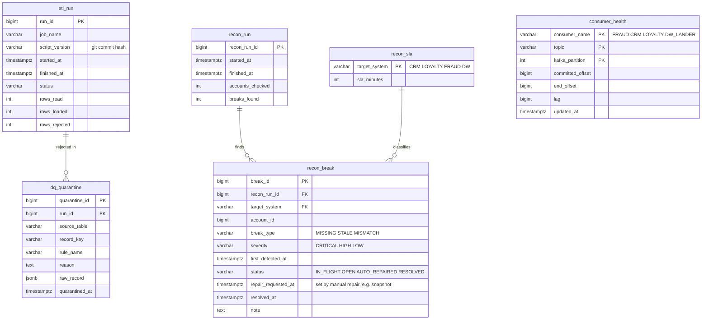

# West City Bank Data Model — Mermaid source

Edit at https://mermaid.live, or import into draw.io via Arrange > Insert > Advanced > Mermaid (one diagram at a time).

Syntax: `type column_name KEY "comment"` inside an entity block; relationships use crow's-foot notation, e.g. `customer ||--o{ account : "holds"` (|| exactly one, o{ zero or many, |{ one or many, o| zero or one).

## 0. System landscape (flowchart)

## 1. core_banking — core banking and customer master

## 2. identity_fraud — identity verification and fraud platform

## 3. crm — customer relationship management

## 4. loyalty — rewards and loyalty platform

## 5. westcity_dw.raw_vault — Data Vault 2.0

## 6. westcity_dw.mart — star schema

## 7. westcity_dw.ops — audit, data quality and reconciliation

